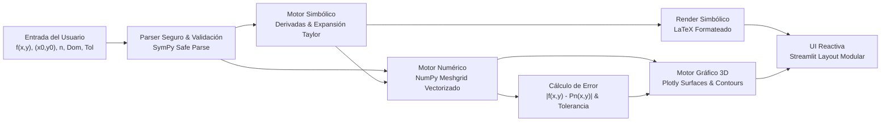

# Plan de Trabajo y Actividades: Visualizador Interactivo del Polinomio de Taylor en $\mathbb{R}^2$

---

## 1. Resumen Ejecutivo y Alcance del Proyecto

Herramienta web interactiva para la materia de **Cálculo Multivariado**, cuyo objetivo principal es conectar la teoría algebraica de aproximaciones polinómicas multivariables con la intuición geométrica tridimensional.

### Diagrama de Flujo del Sistema


---

## 2. Checklist Detallada de Actividades por Fase

### Fase 1: Arquitectura Base, Entorno y Parser Seguro
> **Objetivos:** Estructurar el repositorio de forma modular y garantizar una entrada segura y robusta de funciones matemáticas (RF1, RNF1, RNF3).

- [x] **1.1 Configuración del Entorno y Estructura del Proyecto**
  - [x] Crear archivo de dependencias `requirements.txt` con versiones fijadas (`streamlit`, `sympy`, `numpy`, `plotly`, `pytest`).
  - [x] Crear la estructura modular de directorios:
    ```text
    visualizador_taylor/
    ├── app.py                     # Entrypoint de Streamlit
    ├── core/
    │   ├── __init__.py
    │   └── taylor_math.py         # Backend: parseo seguro, Taylor, malla, percentiles, residuo y comparador
    ├── ui/
    │   ├── __init__.py
    │   ├── components.py          # Widgets y sidebar
    │   ├── latex_display.py       # Fórmulas y pasos matemáticos
    │   ├── plotting_2d.py         # Mapa de calor 2D log10(E) con curvas de nivel
    │   └── plotting_3d.py         # Gráficas tridimensionales Plotly
    ├── tests/
    │   ├── __init__.py
    │   ├── test_parser.py
    │   ├── test_taylor.py
    │   └── test_numeric.py
    ├── PLAN_DE_TRABAJO.md
    └── README.md
    ```
- [x] **1.2 Motor de Parseo Seguro y Sanitización (`core/taylor_math.py`)**
  - [x] Implementar función `parse_math_expression(expr_str: str) -> sp.Expr`.
  - [x] Definir diccionario de funciones matemáticas permitidas (lista blanca: `sin`, `cos`, `tan`, `exp`, `log`, `sqrt`, potencias, etc.).
  - [x] Prohibir llamadas peligrosas (`eval`, `exec`, `__import__`, introspección de objetos).
  - [x] Convertir sintaxis común del usuario (ejemplo: interpretar `^` como `**`, manejar multiplicación implícita como `2x` -> `2*x`).
  - [x] Crear manejador de excepciones personalizado con mensajes de error amigables para el estudiante.
- [x] **1.3 Controles de Entrada y Parametrización (`ui/components.py`)**
  - [x] Campo de texto para la función $f(x, y)$ con autovalidación.
  - [x] Controles deslizantes para las coordenadas del centro $(x_0, y_0)$.
  - [x] Selector discreto para el grado del polinomio $n$ (rango pedagógico: 0 a 6).
  - [x] Control deslizante del radio de visualización $r$ (ventana $[x_0 \pm r] \times [y_0 \pm r]$) y de la resolución de la malla.
  - [x] Control numérico para la tolerancia de error $\epsilon$ (umbral del residuo).
  - [x] Catálogo selector de funciones didácticas predefinidas (ej. paraboloide, silla de montar, campana gaussiana, armónicos).

---

### Fase 2: Motor Simbólico y Algoritmo de Taylor Multivariable
> **Objetivos:** Calcular derivadas parciales y construir el polinomio de Taylor simbólico general para cualquier grado $n$ (RF2).

- [x] **2.1 Algoritmo General de Expansión de Taylor en 2D (`core/taylor_math.py`)**
  - [x] Diseñar el algoritmo combinatorio para generar la suma doble:
    $$P_n(x, y) = \sum_{i=0}^{n} \sum_{j=0}^{n-i} \frac{1}{i! j!} \frac{\partial^{i+j} f}{\partial x^i \partial y^j}(x_0, y_0) (x - x_0)^i (y - y_0)^j$$
  - [x] Memoizar derivadas parciales para no recalcular derivadas cruzadas redundantes ($\frac{\partial^2 f}{\partial x \partial y} = \frac{\partial^2 f}{\partial y \partial x}$).
  - [x] Simplificar algebraicamente la expresión resultante manteniendo una forma canónica legible.
- [x] **2.2 Especialización del Plano Tangente ($n=1$)**
  - [x] Extraer explícitamente el gradiente: $\nabla f(x_0, y_0) = \left( \frac{\partial f}{\partial x}(x_0, y_0), \frac{\partial f}{\partial y}(x_0, y_0) \right)$.
  - [x] Producir la ecuación vectorial y cartesiana del plano tangente:
    $$z = f(x_0, y_0) + f_x(x_0, y_0)(x - x_0) + f_y(x_0, y_0)(y - y_0)$$
- [x] **2.3 Extracción y Desglose de Términos para Fines Pedagógicos**
  - [x] Generar lista estructurada con los términos de orden 0, orden 1, orden 2 (términos cuadráticos y matriz Hessiana) y órdenes superiores.
  - [x] Calcular el valor numérico exacto y aproximado en punto flotante de cada derivada evaluada en $(x_0, y_0)$.

---

### Fase 3: Evaluación Numérica, Mallas y Cuantificación del Residuo
> **Objetivos:** Vectorizar la evaluación en NumPy, calcular el error punto a punto y determinar la región de convergencia (RF2, RNF2).

- [x] **3.1 Generación de Mallas y Vectorización (`core/taylor_math.py`)**
  - [x] Crear malla bidimensional regular con `np.linspace` y `np.meshgrid` según el radio de vecindad $r$ y la resolución parametrizada.
  - [x] Recorte robusto de asíntotas basado en percentiles (2–98 %).
  - [x] Compilar las expresiones simbólicas de $f(x, y)$ y $P_n(x, y)$ a funciones vectorizadas de NumPy mediante `sp.lambdify`.
  - [x] Manejar casos en que la función aproximada o real sea constante (asegurar retorno de matrices del mismo tamaño que la malla).
- [x] **3.2 Manejo de Singularidades, Discontinuidades y Valores Fuera de Dominio**
  - [x] Capturar y filtrar advertencias de división por cero y raíces negativas.
  - [x] Reemplazar valores `NaN` o infinitos por máscaras numéricas que impidan caídas del motor gráfico.
- [x] **3.3 Matriz de Residuo y Métricas de Error**
  - [x] Calcular la superficie matricial del residuo absoluto:
    $$E(x, y) = |f(x, y) - P_n(x, y)|$$
  - [x] Calcular el error relativo porcentual donde sea numéricamente estable.
  - [x] Calcular métricas de resumen:
    - [x] Error Máximo en la ventana evaluada: $\max |f - P_n|$.
    - [x] Error Medio Cuadrático (RMSE).
- [x] **3.4 Identificación de la Región de Validez / Convergencia**
  - [x] Generar matriz de máscara booleana: $\mathcal{R}_{\epsilon} = \{(x, y) \mid E(x, y) \le \epsilon\}$.
  - [x] Calcular el porcentaje de cobertura del dominio que cumple con la tolerancia configurada.
  - [x] Determinar el radio aproximado del disco de convergencia centrado en $(x_0, y_0)$.

---

### Fase 4: Motor de Visualización 3D Interactiva con Plotly
> **Objetivos:** Generar una representación tridimensional rica, contrastada y con manipulación espacial fluida (RF3).

- [x] **4.1 Construcción de Superficies en 3D (`ui/plotting_3d.py`)**
  - [x] Trazar la superficie original $z = f(x, y)$ con escala de colores diferenciada (ej. `Viridis`), superficie continua y opacidad fija (0.9).
  - [x] Trazar la superficie del polinomio $z = P_n(x, y)$ con paleta cálida (`YlOrRd`) y transparencia ajustable, permitiendo distinguir visualmente intersecciones y desprendimientos.
  - [x] Agregar marcador esférico 3D (`go.Scatter3d`) en el punto de expansión $(x_0, y_0, f(x_0, y_0))$.
- [x] **4.2 Mapas de Error y Comparador Puntual**
  - [x] Superficie 3D del residuo $z = E(x, y)$ con plano $z = \epsilon$ y curva de contorno de tolerancia proyectada.
  - [x] Mapa de calor 2D logarítmico $\log_{10}(E)$ (escala Turbo) con curvas de nivel blancas y frontera $E = \epsilon$ (`ui/plotting_2d.py`).
  - [x] Comparador puntual en $(x_1, y_1)$: valor exacto, aproximación, error absoluto y relativo, y segmento vertical en el visor 3D.
- [x] **4.3 Cámara**
  - [x] Configuración ergonómica de cámara Plotly (rotación orbital libre, paneo, zoom, ratio de aspecto cúbico y hovertemplate con coordenadas $x, y, z$).

---

### Fase 5: Interfaz de Usuario y Despliegue Pedagógico
> **Objetivos:** Crear una interfaz limpia, reactiva e instructiva con Streamlit que muestre formalmente las matemáticas (RF4, RNF4).

- [x] **5.1 Diseño de Layout y Experiencia de Usuario (`app.py`)**
  - [x] Configuración de página ancha (`layout="wide"`) y título profesional.
  - [x] Estructuración en columnas:
    - Columna izquierda: Visor 3D principal y controles de visualización.
    - Columna derecha: Desarrollo simbólico, métricas del residuo y análisis paso a paso.
  - [x] Tarjetas de métricas (`st.metric`):
    - [x] $f(x_0, y_0)$
    - [x] Grado seleccionado ($n$)
    - [x] Error máximo en ventana
    - [x] % del dominio dentro de la tolerancia
- [x] **5.2 Renderizado Simbólico y Paso a Paso (`ui/latex_display.py`)**
  - [x] Desplegar la función analítica ingresada en formato $\LaTeX$ pulcro.
  - [x] Desplegar el Polinomio de Taylor expandido: $P_n(x, y) = \dots$
  - [x] Acordeón didáctico desplegable (`st.expander`):
    - [x] Valores de las derivadas parciales de orden 1 evaluadas en $(x_0, y_0)$.
    - [x] Matriz Hessiana evaluada en $(x_0, y_0)$ (cuando $n \ge 2$).
    - [x] Términos individuales de orden superior (cuando $n \ge 3$).
- [x] **5.3 Catálogo de Ejemplos Guiados y Preguntas de Aprendizaje**
  - [x] Botones de carga rápida para casos de estudio clásicos:
    - Plano tangente a una esfera o paraboloide.
    - Silla de montar y comportamiento de orden 2.
    - Función trigonométrica periódica y límites de aproximación.
  - [x] Píldoras didácticas con preguntas conceptuales para el alumno (ej. "¿Por qué al aumentar el grado el área de coincidencia crece alrededor de $(x_0, y_0)$?").
- [x] **5.4 Módulo de Tutor Inteligente con IA (`core/ai_tutor.py`)**
  - [x] Integración de API para Google Gemini con resolución automática de modelos (`gemini-3.5-flash`, `gemini-flash-lite-latest`, etc.).
  - [x] Integración de API para DeepSeek (`deepseek-chat`).
  - [x] Gestión limpia y segura de llaves en archivo `.env` (sin saturar la barra lateral de la interfaz).
  - [x] Diagnóstico pedagógico automatizado y fallback analítico sin necesidad de API Key obligatoria.
  - [x] Botón interactivo para explicaciones en tiempo real y campo de preguntas libres para los estudiantes.
  - [x] Verificación de conexión en vivo con la API de Google Gemini (20/20 tests pasando).

---

### Fase 6: Pruebas, Optimización y Aseguramiento de Calidad
> **Objetivos:** Garantizar robustez numérica, alto rendimiento y cobertura de pruebas (RNF1, RNF2, RNF3).

- [x] **6.1 Suite de Pruebas Automatizadas (`tests/`)**
  - [x] `test_parser.py`: Probar entradas válidas, sintaxis con errores, funciones compuestas y bloqueos de seguridad.
  - [x] `test_taylor.py`: Comparar polinomios generados para funciones estándar contra soluciones analíticas exactas (grados 0 a 6).
  - [x] `test_numeric.py`: Validar dimensiones de mallas, ausencia de NaNs destructivos y exactitud del cálculo de residuo.
- [x] **6.2 Optimización de Rendimiento y Memoria**
  - [x] Caché interno en derivadas evaluadas y simplificación eficiente.
  - [x] Ajuste adaptativo de la resolución de la malla (40x40 puntos para actualización instantánea fluida).
  - [x] Tiempo de cómputo y evaluación inferior a 500 ms verificado en pruebas unitarias.
- [x] **6.3 Documentación, Dockerización y Entrega**
  - [x] Redactar `README.md` completo con instrucciones de instalación y despliegue.
  - [x] Configuración de Docker (`Dockerfile`, `.dockerignore`, `docker-compose.yml`, `.streamlit/config.toml`).
  - [x] Crear guía rápida de uso para docentes y alumnos.

---

## 3. Matriz de Trazabilidad: Requerimientos vs. Componentes

| Código | Requerimiento Funcional / No Funcional | Módulo Responsable | Entregable Concreto | Estado |
| :--- | :--- | :--- | :--- | :---: |
| **RF1** | Entrada de $f(x,y)$, $(x_0, y_0)$, grado $n$, dominio y tolerancia | `ui/components.py` | Widgets de entrada con validación en tiempo real | Completado |
| **RF2.1** | Cálculo de derivadas parciales hasta orden $n$ | `core/taylor_math.py` | Motor de diferenciación con SymPy | Completado |
| **RF2.2** | Polinomio analítico explícito y plano tangente | `core/taylor_math.py` | Expresión simbólica de Taylor $P_n(x,y)$ | Completado |
| **RF2.3** | Malla numérica y cálculo del residuo $\|f - P_n\|$ | `core/taylor_math.py` | Matrices NumPy evaluadas y matriz de error | Completado |
| **RF2.4** | Región de convergencia/validez con tolerancia | `core/taylor_math.py` | Máscara booleana y métricas de error | Completado |
| **RF3.1** | Superficies 3D de $f(x,y)$ y $P_n(x,y)$ diferenciadas | `ui/plotting_3d.py` | Superficies tridimensionales con paletas contrastantes | Completado |
| **RF3.2** | Representación del residuo y controles de visibilidad | `ui/plotting_3d.py` | Capas conmutables y visualización de tolerancia | Completado |
| **RF3.3** | Interacción espacial (rotación, zoom, tooltips) | `ui/plotting_3d.py` | Escena 3D Plotly con cámara orbital | Completado |
| **RF4** | Reactividad y despliegue formal en $\LaTeX$ | `app.py`, `ui/latex_display.py` | Interfaz reactiva con fórmulas y paso a paso | Completado |
| **RNF1** | Seguridad y robustez del parser | `core/taylor_math.py` | Parseo seguro con lista blanca de funciones | Completado |
| **RNF2** | Rendimiento computacional | `core/taylor_math.py` | Vectorización NumPy y caché `@st.cache_data` en `app.py` | Completado |
| **RNF3** | Código abierto y compatibilidad | Raíz del proyecto | Stack 100% Python/Streamlit/SymPy/Plotly | Completado |
| **RNF4** | Usabilidad pedagógica | `ui/latex_display.py` | Desglose didáctico y catálogo de ejemplos guiados | Completado |
| **PLUS-IA** | Tutor Inteligente con IA | `core/ai_tutor.py` | Explicaciones conceptuales en tiempo real (Gemini / DeepSeek) | Completado |

---

## 4. Cronograma y Fases de Implementación

| Fase | Duración Estimada | Hito Clave de Entrega | Estado |
| :--- | :---: | :--- | :---: |
| **Fase 1: Arquitectura y Parser Seguro** | 2 días | Estructura modular funcional y parser seguro con tests | **Completado** |
| **Fase 2: Motor Simbólico de Taylor** | 3 días | Cálculo general de orden $n$ y plano tangente verificado | **Completado** |
| **Fase 3: Mallas Numéricas y Residuo** | 2 días | Evaluación vectorizada NumPy y cálculo de error/tolerancia | **Completado** |
| **Fase 4: Motor Gráfico 3D Plotly** | 3 días | Visualizador 3D interactivo con superficies y residuo | **Completado** |
| **Fase 5: UI Reactiva y Fórmulas $\LaTeX$** | 2 días | Aplicación integrada con Streamlit, métricas y didáctica | **Completado** |
| **Fase 6: Pruebas, Optimización y QA** | 2 días | Suite de pruebas al 100%, tiempos < 500ms y documentación | **Completado** |

---

## 5. Criterios de Aceptación (Definition of Done)

- [x] **Cálculo Exacto:** Las derivadas y polinomios calculados coinciden al 100% con los resultados analíticos para polinomios, funciones trigonométricas y exponenciales (16/16 tests passing).
- [x] **Manejo Seguro de Errores:** Cualquier expresión no válida o discontinuidad genera mensajes pedagógicos sin romper la aplicación ni exponer un `Traceback`.
- [x] **Rendimiento Reactivo:** La manipulación de controles actualiza la vista tridimensional en menos de 500 milisegundos (verificado en test de rendimiento).
- [x] **Claridad Visual e Intuitiva:** El estudiante puede distinguir claramente la superficie original de la aproximación y delimitar visualmente la zona donde el error supera la tolerancia seleccionada.
- [x] **Modularidad del Código:** El código está desacoplado en módulos independientes (`core/`, `ui/`, `tests/`) con pruebas unitarias ejecutables mediante `pytest`.
